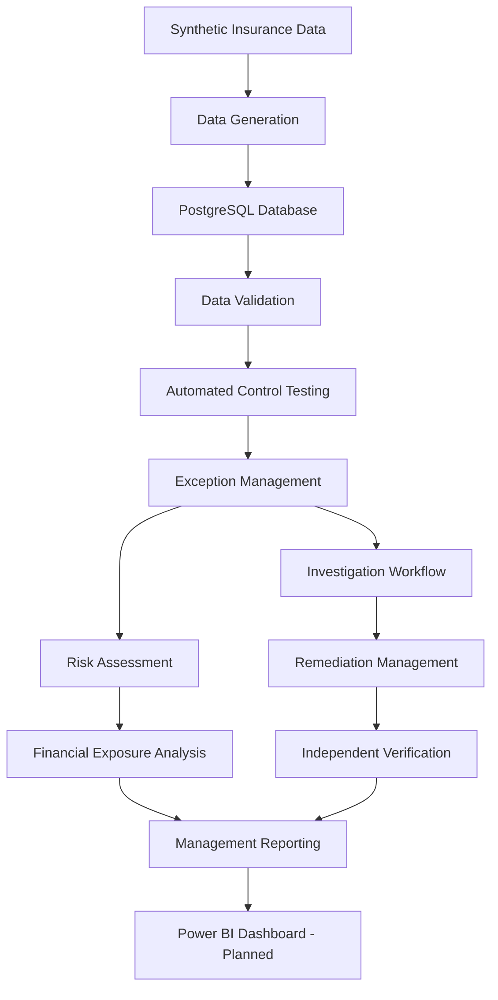

# InsureGuard — Insurance Claims & Payment Risk Intelligence Platform

**A data-driven risk and control monitoring platform for identifying insurance claims and payment exceptions, assessing financial exposure, and supporting risk-based investigations.**

> Project type: Portfolio Project  
> Domain: Insurance | Risk Management | Internal Controls | Financial Analytics  
> Technologies: Python, PostgreSQL, SQL, Pandas, NumPy, Power BI (planned)

---

## 1. Overview

Insurance companies process large volumes of claims and payments. Weaknesses in payment authorization, duplicate-payment prevention, and settlement verification can create financial exposure and operational risks.

**InsureGuard** is a simulated insurance risk intelligence platform designed to help an insurance organization identify potential control failures, quantify associated financial exposure, prioritize risks, and track investigation and remediation activities.

The project uses synthetic insurance data to demonstrate how data analytics, automated control testing, and risk assessment can support insurance operations, finance, risk management, and compliance teams.

The platform follows a structured approach:

**Identify → Assess → Quantify → Investigate → Remediate → Report**

---

## 2. Business Problem

Insurance claims and payment processes involve multiple stages, including claim approval, payment authorization, settlement, and reconciliation.

Failures in these processes may result in:

- Payments without valid authorization.
- Duplicate payment transactions.
- Payments exceeding approved settlement amounts.
- Incomplete financial controls and weak audit trails.
- Delayed identification and resolution of control exceptions.

The objective of InsureGuard is to transform transaction-level data into actionable risk information that supports better monitoring, investigation, and management decisions.

---

## 3. Project Objectives

- Build a structured insurance claims and payments database.
- Generate and validate realistic synthetic insurance transactions.
- Develop automated rules to identify payment-control exceptions.
- Assess risks using likelihood and impact.
- Estimate potential financial exposure associated with identified exceptions.
- Maintain investigation records and supporting evidence.
- Assign remediation actions and demonstrate independent verification.
- Provide a foundation for management-level risk reporting.

---

## 4. System Architecture



---

## 5. Key Features

### 5.1 Data Generation and Validation

Generated synthetic insurance datasets covering:

- Customers
- Employees and organizational departments
- Insurance policies
- Claims
- Claim approvals
- Payment transactions

Data validation checks include duplicate identifiers, referential integrity, approval relationships, payment timing, and settlement inconsistencies.

### 5.2 Automated Control Testing

The control engine evaluates payment transactions against defined business rules.

| Control ID | Control | Objective |
|---|---|---|
| CT-001 | Payment Authorization Verification | Identify payments without valid approval references |
| CT-002 | Duplicate Payment Detection | Identify potentially duplicated payment transactions |
| CT-003 | Settlement Amount Verification | Identify claims where successful payments exceed approved settlement amounts |
| CT-004 | Documentation Completeness | Define documentation requirements |
| CT-005 | Claim Payment Reconciliation | Support claim-to-payment reconciliation |
| CT-006 | Segregation of Duties | Define separation between approval and execution |
| CT-007 | Approval Authority Verification | Verify approval authority against defined limits |
| CT-008 | Settlement SLA Monitoring | Define settlement timeliness monitoring |

The initial automated testing implementation focuses on CT-001, CT-002, and CT-003.

### 5.3 Risk Assessment

Risks are assessed using a likelihood-impact methodology.

**Inherent Risk Score = Likelihood × Impact**

Both factors are measured on a scale of 1–5.

| Score | Risk Rating |
|---|---|
| 1–4 | Low |
| 5–9 | Moderate |
| 10–15 | High |
| 16–25 | Critical |

The platform also includes an illustrative residual-risk calculation based on assumed control effectiveness.

### 5.4 Financial Exposure Analysis

The financial exposure engine calculates potential exposure associated with identified payment exceptions.

It evaluates:

- Payments flagged for missing or invalid authorization.
- Potential duplicate payment amounts.
- Excess settlement amounts.

These values represent **potential exposure requiring investigation**, not confirmed financial losses or proven fraud.

Exposure categories may overlap and should not be added together without transaction-level reconciliation.

### 5.5 Investigation Management

Investigation records support:

- Assignment of investigation cases.
- Recording findings and root causes.
- Capturing evidence references.
- Recording investigation outcomes.
- Maintaining investigation update history.

### 5.6 Remediation and Verification

The remediation workflow supports:

- Assignment of corrective actions.
- Due-date and status tracking.
- Submission for independent review.
- Recording verification decisions.
- Maintaining verification evidence.

The implementation includes a demonstration of the independent verification process. Full organizational authentication and production-grade workflow governance are outside the current scope.

---

## 6. Technology Stack

| Technology | Purpose |
|---|---|
| Python | Data processing and business logic |
| PostgreSQL | Relational database management |
| SQL | Data modelling, validation, and querying |
| Pandas | Data manipulation and analysis |
| NumPy | Synthetic data generation |
| SQLAlchemy | Database connectivity |
| python-dotenv | Environment configuration |
| Power BI | Planned management dashboard |

---

## 7. Dataset Overview

The project uses entirely synthetic data.

| Dataset | Records |
|---|---:|
| Customers | 8,000 |
| Employees | 100 |
| Departments | 4 |
| Roles | 5 |
| Policies | 10,000 |
| Claims | 5,000 |
| Claim Approvals | 4,915 |
| Payments | 5,043 |

The synthetic transaction dataset includes deliberately introduced exception scenarios to test the control engine.

### Initial Exception Scenarios

- Missing payment authorization.
- Duplicate payment transactions.
- Settlement overpayments.
- Approval authority breaches.

The data is intended for analytical demonstration and does not represent real insurance customers, policies, claims, or payments.

---

## 8. Initial Analytical Findings

The initial control-testing run identified the following exceptions:

| Control | Exceptions Identified |
|---|---:|
| CT-001 — Payment Authorization | 92 |
| CT-002 — Duplicate Payments | 85 |
| CT-003 — Settlement Verification | 85 |
| **Total** | **262** |

### Potential Financial Exposure

| Risk Category | Potential Exposure |
|---|---:|
| Unauthorized Claim Payments | ₹1,60,32,959.58 |
| Duplicate Payment Exposure | ₹1,66,10,495.36 |
| Incorrect Settlement Amounts | ₹28,12,116.16 |

**Important interpretation:**

- These are initial analytical results from synthetic data.
- The figures are potential exposure estimates, not confirmed losses.
- Exception counts across different controls may relate to overlapping transactions.
- Duplicate-payment flags require investigation before confirming an actual duplicate disbursement.

---

## 9. Project Structure

```text
Insure_Guard/
│
├── database/
│   ├── 02_create_tables.sql
│   ├── 03_seed_control_library.sql
│   └── 04_create_risk_control_mapping.sql
│
├── data/
│   ├── raw/
│   └── processed/
│
├── notebooks/
│
├── src/
│   ├── database/
│   ├── data_generation/
│   ├── data_validation/
│   ├── control_engine/
│   ├── risk_engine/
│   ├── investigation_engine/
│   └── remediation_engine/
│
├── tests/
├── powerbi/
├── reports/
├── requirements.txt
├── .gitignore
└── README.md
```

---

## 10. Getting Started

### Prerequisites

- Python 3.10 or later
- PostgreSQL
- Git
- VS Code or another Python IDE

### Clone the repository

```bash
git clone <YOUR_GITHUB_REPOSITORY_URL>
cd Insure_Guard
```

### Create a virtual environment

```bash
python -m venv .venv
```

Activate it on Windows:

```bash
.venv\Scripts\activate
```

### Install dependencies

```bash
pip install -r requirements.txt
```

### Configure database credentials

Create a `.env` file in the project root:

```env
DB_USER=your_database_user
DB_PASSWORD=your_database_password
DB_HOST=localhost
DB_PORT=5432
DB_NAME=insureguard
```

Never commit `.env` or real credentials to GitHub.

### Database setup

Create the PostgreSQL database named `insureguard`, then execute the SQL schema and seed scripts in the appropriate order.

Run the data generation, loading, validation, and analysis modules from the project root after configuring the database.

---

## 11. Current Implementation Status

| Component | Status |
|---|---|
| Business problem and system design | Implemented |
| PostgreSQL database architecture | Implemented |
| Synthetic data generation | Implemented |
| Data validation | Implemented |
| Automated control testing | Implemented |
| Risk assessment engine | Implemented |
| Financial exposure analysis | Implemented |
| Investigation management | Implemented |
| Investigation audit history | Implemented |
| Remediation management | Implemented |
| Independent verification workflow | Basic implementation |
| Power BI management dashboard | In development |
| Comprehensive QA and final documentation | Pending |

---

## 12. Limitations and Future Enhancements

Planned improvements include:

- Executive-level Power BI risk dashboards.
- Department-wise and time-based risk analysis.
- Enhanced control-effectiveness monitoring.
- More comprehensive investigation and evidence workflows.
- Automated remediation aging and overdue monitoring.
- Expanded test coverage and data-quality checks.
- Improved audit governance and authenticated user tracking.

This is an educational portfolio project, not a production insurance risk-management system. Its synthetic data, illustrative risk methodology, and simulated workflows should not be interpreted as regulatory certification or an assessment of a real insurer.

---

## 13. Business Value

InsureGuard demonstrates how structured data analytics and automated controls can support:

- Earlier identification of payment-control weaknesses.
- Better visibility into potential financial exposure.
- Risk-based prioritization of investigations.
- More traceable remediation activities.
- Improved communication of operational risks to management.

The broader objective is to connect transaction-level analysis with practical risk-management decisions.

---

## 14. Author and Project

**InsureGuard — Insurance Claims & Payment Risk Intelligence Platform**

Developed as an independent portfolio project to explore the intersection of data analytics, insurance operations, financial controls, and risk management.

**Technologies:** Python | PostgreSQL | SQL | Pandas | NumPy | Power BI

